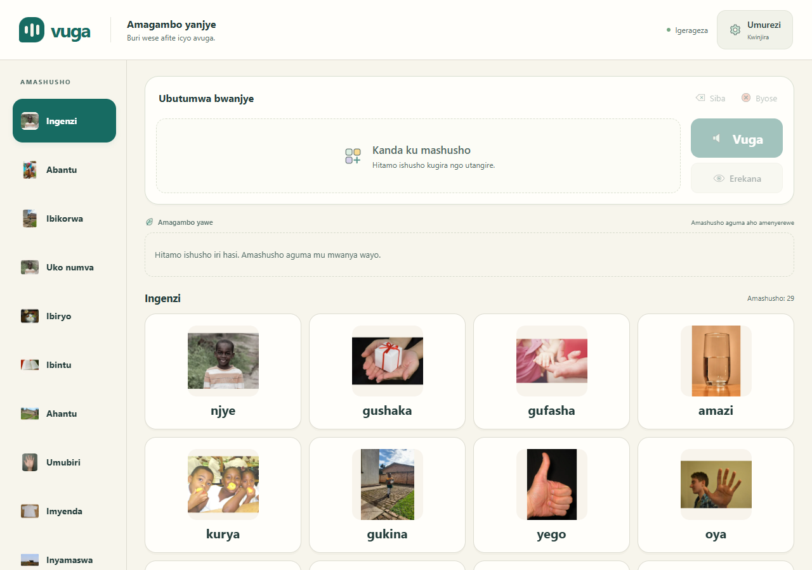
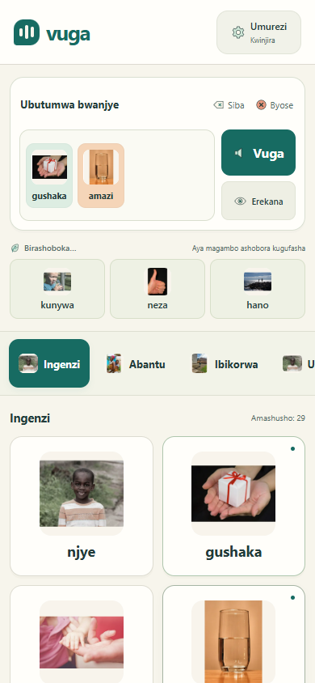
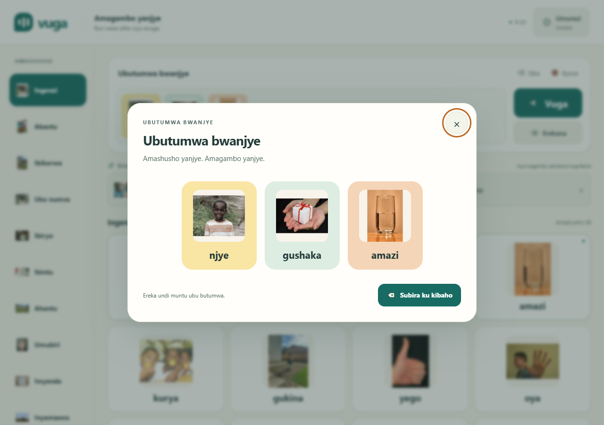
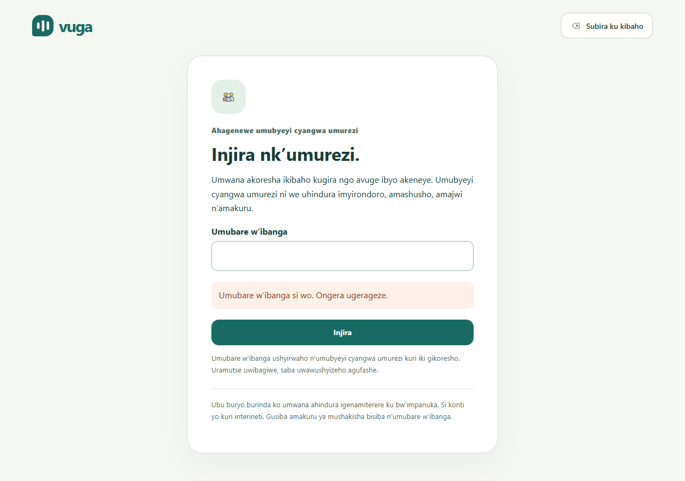
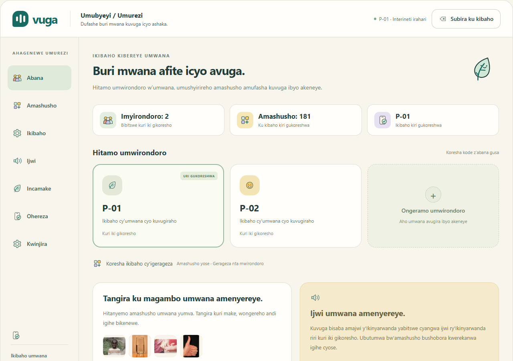
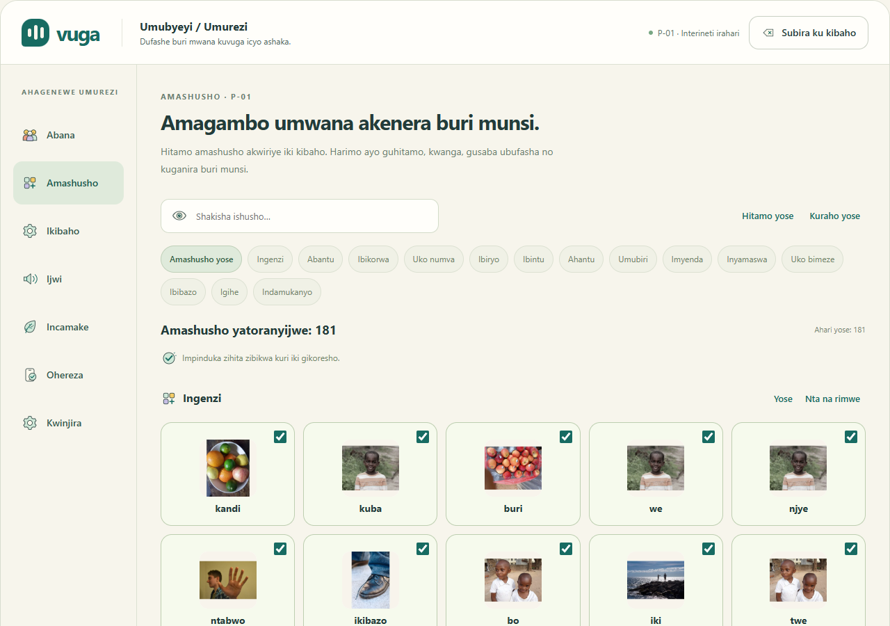
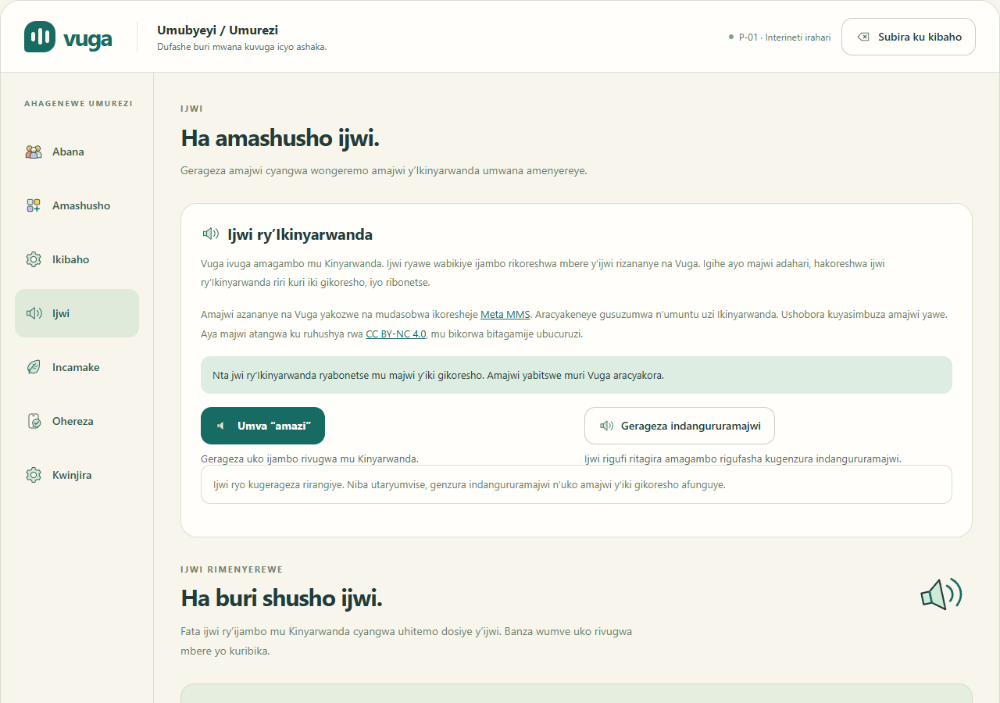
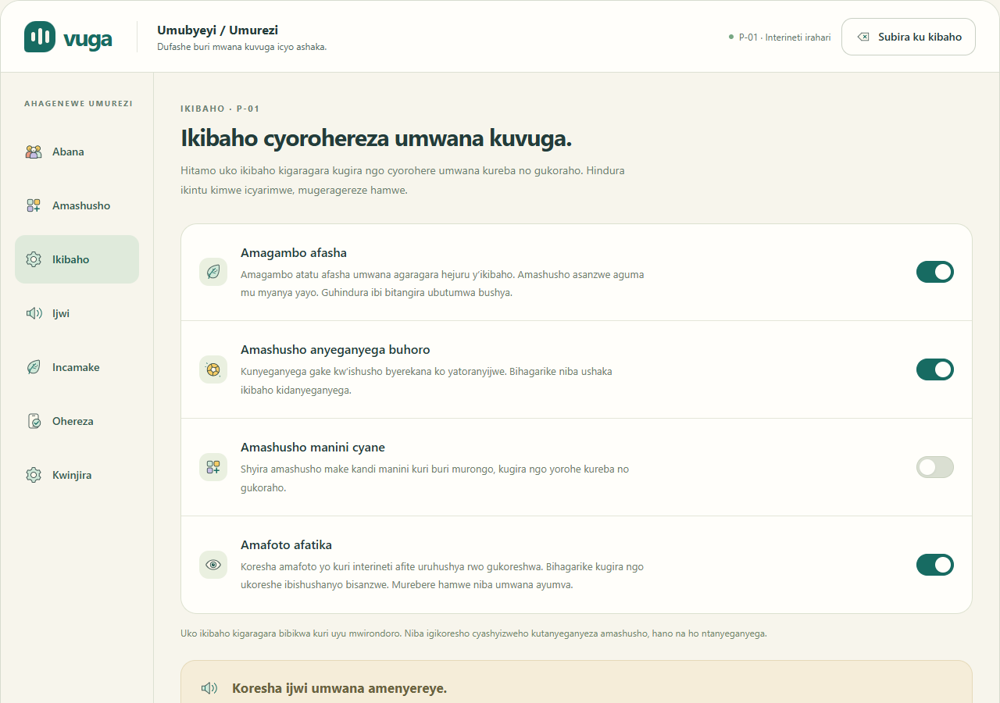

# Vuga AAC

**An offline Kinyarwanda picture-to-speech communication board for children with complex communication needs, with machine-learning next-symbol suggestions.**

| | |
|---|---|
| **GitHub repository** | https://github.com/jbyiringiro/capstone-project |
| **Video demo** | [Watch the demo on Google Drive](https://drive.google.com/file/d/16Nq9ihLEjOk3gUrY7Ac3sgkN2MsOsO_b/view?usp=drive_link) |
| **Author** | Josue Byiringiro, BSc Software Engineering (Machine Learning), African Leadership University |
| **Supervisor** | Junior Turatsinze |

## Description

**Problem.** Some children cannot rely on speech to ask for help, make a choice, refuse something or join in a conversation. Rwanda's child census identifies children with communication difficulties ([NISR children report](https://beta.statistics.gov.rw/file/14175/download?token=zQsSYuB4)). Augmentative and alternative communication (AAC) tools can help ([ASHA AAC overview](https://www.asha.org/Practice-Portal/Professional-Issues/Augmentative-and-Alternative-Communication/)). Most AAC apps, however, are English-first, paid, or need a constant internet connection.

**Solution.** Vuga ("speak" in Kinyarwanda) is a progressive web app that runs on an ordinary Android tablet or phone and works fully offline after the first load.

- A child taps picture cards to build a message, then shows it on screen with **Erekana** ("show") or speaks it aloud in Kinyarwanda with **Vuga**.
- There are 181 everyday words, each with a licensed picture and a bundled Kinyarwanda speech clip.
- Caregivers open **Umurezi** ("caregiver") behind a parent PIN. There they manage child profiles, vocabulary, picture style, speech (including their own recordings), an activity summary, and explicit export or sync.
- All data stays on the device unless a caregiver chooses to sync it.

**Machine learning.** A next-symbol predictor suggests likely next words in a separate row, so the main board's layout never moves. The [model notebook](ml/notebooks/vuga_model.ipynb) ([HTML version](ml/notebooks/vuga_model.html)) covers data engineering, visualisations, model architecture and metrics. It compares three models trained on Kinyarwanda sentences mapped to the board vocabulary:

| Model | Validation top-3 accuracy |
|---|---|
| Frequency baseline | 21.96% |
| Kneser-Ney trigram | 45.78% |
| GRU | 46.92% |

The app ships the small trigram model because it is almost as accurate as the GRU, runs instantly offline, and is only about 100 KB.

**Architecture.**
- **App:** React + Vite PWA with Dexie (IndexedDB) storage and a service-worker cache.
- **API (optional):** FastAPI with Swagger UI, SQLAlchemy over SQLite or PostgreSQL, JWT authentication, sync, summaries and `/predict`.
- **ML package and notebook:** in `ml/`.

**Status (12 October 2026).** This is an initial demonstration.
- The interface, pictures, speech, parent access and prediction work, and are covered by automated and browser tests.
- The speech is synthetic (Meta MMS-TTS) and has not yet been reviewed by a native speaker.
- No school, caregiver or therapist has evaluated the app yet, and no participant findings are claimed.

The app's labels, dialogs, accessible names and messages are in Kinyarwanda. Developer documentation is in English.

## Set up the environment and run the project

**Prerequisites:**
- Git
- [Node.js 20](https://nodejs.org/) with npm, for the app
- [Python 3.11+](https://www.python.org/), for the notebook and API (optional)

### 1. Get the code

```sh
git clone https://github.com/jbyiringiro/capstone-project.git
cd capstone-project
```

If you downloaded the ZIP from GitHub instead, unzip it and open a terminal in the extracted folder.

### 2. Run the app (communication board)

```sh
cd app
npm ci              # install dependencies
npm test            # run the unit tests
npm run build       # production build with offline service worker
npm run preview -- --host 127.0.0.1
```

Open http://localhost:4173. For development with hot reload, run `npm run dev` and open http://localhost:5173. On Windows PowerShell, use `npm.cmd` if the execution policy blocks `npm`.

**Using the app:**
- The board opens directly, with no account or PIN. Tap pictures to build a message, then press **Vuga** to hear it or **Erekana** to show it full screen.
- Hold **Umurezi** (or activate it by keyboard) for the caregiver area. On first use, a parent chooses a four-to-six-digit PIN. Setup can be dismissed without blocking the child.
- Parent tabs are **Abana** (profiles), **Amashusho** (pictures), **Ikibaho** (board), **Ijwi** (speech), **Incamake** (summary), **Ohereza** (export/sync) and **Kwinjira** (change PIN).

### 3. Set up Python, the notebook and the API (optional)

From the repository root:

```sh
python -m venv .venv
# Windows: .venv\Scripts\activate    macOS/Linux: source .venv/bin/activate
python -m pip install -e "./ml[dev,notebook]" -e "./api[dev]"

python ml/notebooks/run_notebook.py          # re-run the model notebook
python -m pytest ml/tests api/tests          # run the Python tests
python -m uvicorn app.main:app --app-dir api --host 127.0.0.1 --port 8000
```

Open Swagger UI at http://localhost:8000/docs.

**API configuration.** Copy `.env.example` to `.env` to configure the API:
- Set `VUGA_MODEL_DIR` to `ml/artifacts`.
- Set `VUGA_CORS_ORIGINS` to the app's origin.
- For persistent sessions, set `VUGA_JWT_SECRET` to a private value of at least 32 characters. Without it, local development uses a temporary key.

To run the API with PostgreSQL in Docker instead, set `VUGA_JWT_SECRET` and run `docker compose up`.

The notebook reads the committed `ml/notebooks/evidence/` snapshot. It does not download the corpus or retrain the neural models. To regenerate the trigram model from that snapshot, run `python ml/scripts/export_artifacts.py --data ml/notebooks/evidence`. Optional neural tests need `ml[neural]`.

More detail: [project guide](docs/project_guide.md).

## Designs

**Screenshots of the working app** (from [docs/screenshots/licensed-2026-10-10](docs/screenshots/licensed-2026-10-10/)):

| Communication board (tablet/desktop) | Board on a phone, offline |
|---|---|
|  |  |
| **Message shown full screen (Erekana)** | **Parent PIN unlock** |
|  |  |
| **Caregiver: child profiles** | **Caregiver: vocabulary** |
|  |  |
| **Caregiver: speech and recordings** | **Caregiver: board preferences** |
|  |  |

**Figma mockups and design system** (in [design/](design/README.md)):
- 16 screen mockups (tablet and phone) as Figma-importable SVGs in [design/figma-import/](design/figma-import/), with PNG previews in [design/previews/](design/previews/). For example: [all screens](design/previews/all-screens.png), [tablet board](design/previews/tablet-board.png), [compose](design/previews/tablet-compose.png), [mobile board](design/previews/mobile-board.png).
- Style foundations ([foundations.html](design/foundations.html), [foundations sheet](design/previews/foundations-system.png)), design tokens ([tokens.json](design/tokens.json)) and 25 custom icons ([icon sheet](design/assets/icons-contact-sheet.png)).
- An interactive clickable preview: open [design/preview.html](design/preview.html) in a browser.

The mockups record the earlier visual design. The running app (screenshots above) is the current version, with Kinyarwanda text and licensed photographs.

**Circuit diagram.** Not applicable. Vuga is a software project that runs on existing tablets and phones. The physical-access parts in `hardware/` (a 3D-printable keyguard) and `device/` (firmware scaffold for a possible talker box) are early drafts and have not been built.

## Deployment plan

The full plan is in [docs/deployment_plan.md](docs/deployment_plan.md). In summary:

1. **Phase 0, local preview (done):** `npm run build` and `npm run preview`, as shown in the video demo.
2. **Phase 1, public app:** publish the static PWA (`app/dist`) on Netlify or Cloudflare Pages over HTTPS. The board needs no server, so this alone makes it usable. A tablet installs the app once and then works offline.
3. **Phase 2, optional API:** deploy `api/Dockerfile` to Render with managed PostgreSQL, secrets set as environment variables, CORS limited to the app's domain, and a `/health` check.
4. **Phase 3, pilot:** only after a native speaker reviews the speech and caregivers review the vocabulary and pictures.

The plan also covers configuration, checks after each deploy, rollback, privacy for children's data, licensing and cost ($0 for the demo).

## Code files

| Folder | Contents |
|---|---|
| `app/` | React PWA: communication board, caregiver screens, speech, prediction, offline storage, tests |
| `api/` | FastAPI backend (auth, profiles, vocabulary, sync, summary, prediction), database models, Dockerfile, tests |
| `ml/` | Prediction models (unigram, trigram, GRU), training and export scripts, model notebook, tests |
| `vocab/` | The 181-word Kinyarwanda vocabulary and lexicon |
| `design/` | Figma mockups, design tokens, icons and previews |
| `docs/` | Project guide, deployment plan, verification records and screenshots |
| `hardware/`, `device/` | Keyguard and talker-box firmware drafts (not yet built) |
| `scripts/` | Asset generation (pictures, speech) |

Key source files:

| Component | Location |
|---|---|
| Board and caregiver UI | `app/src/Board.jsx`, `app/src/Dashboard.jsx` |
| Profiles, vocabulary and messages | `app/src/db.js`, `app/src/message-session.js` |
| Parent access | `app/src/ParentAccess.jsx`, `app/src/parent-access.js` |
| Speech and recordings | `app/src/speech.js`, `app/src/VoiceSettings.jsx`, `app/src/AudioSettings.jsx` |
| Next-symbol prediction (in app) | `app/src/predictor.js` |
| API endpoints, schemas, database models | `api/app/main.py`, `api/app/schemas.py`, `api/app/models.py` |
| ML models and training | `ml/vuga_ml/` |

## Pictures and Kinyarwanda speech

**Pictures.** Each card uses a licensed online image, bundled locally in `app/public/photos/` so it works offline. The [photo manifest](app/public/photos/manifest.json) records source pages, authors, licences and hashes. These are not photographs of project participants. **Umurezi → Ikibaho → Amafoto afatika** switches a profile to ARASAAC pictograms instead. Fetch those with `python ml/scripts/fetch_pictograms.py`; they have their own licence.

**Speech.** The app bundles **181 synthetic Kinyarwanda WAV clips**, generated from the exact `label_rw` entries in `vocab/symbols.csv` with Meta AI's pinned `facebook/mms-tts-kin` model. They have not been reviewed by a native speaker.
- **Playback order:** a caregiver's saved recording, then an installation's `/audio/SYMBOL.wav`, then the bundled `/audio/rw/SYMBOL.wav`, then a Kinyarwanda system voice if one is installed. English is never used as a fallback.
- **If speech fails,** the message is kept and **Erekana** is offered.
- **Caregiver recordings:** in **Umurezi → Ijwi**, a caregiver can record or upload, preview, save or delete a recording for any word. Recordings stay on the device and are excluded from export, sync and the repository.

Details: [audio setup](app/public/audio/README.md) and [speech licensing and generation](app/public/audio/rw/README.md).

**Parent access security.**
- Parent access locks when the user returns to the board, reloads the page, leaves the app in the background, or makes no input for five minutes.
- Five failed PIN attempts start a 30-second cooldown.
- Only a salted PBKDF2-derived credential is stored.

This PIN is a local guard against accidental settings changes. It is not a server account.

## Verification

The [current implementation record](docs/licensed_images_parent_access_2026-10-10.md) has the executed checks and screenshots. They cover:
- asset provenance and hashes
- offline use of images and audio
- child communication
- PIN setup, unlock and change
- cooldown persistence
- draft preservation
- automatic locking

The API and ML results are from September; the later interface changes did not retrain the predictor.

This repository includes the bundled pictures, Kinyarwanda speech, the trigram model and the executed notebook. It does not include dependencies (`node_modules`, `.venv`), model weights or private data; install those with the setup steps above.

## Licences

| Material | Licence |
|---|---|
| Code | MIT |
| Online pictures | Per-image licence and attribution, recorded in the photo manifest |
| Original vocabulary translations and permitted human recordings | CC BY 4.0 |
| **Synthetic Kinyarwanda speech** (Meta AI MMS-TTS) | **CC BY-NC 4.0** (non-commercial). Its provenance and licence notice ship with the bundle |
| ARASAAC pictograms | CC BY-NC-SA 4.0 |
| Training text (Digital Umuganda Common Voice Kinyarwanda sentence corpus, pinned by commit) | MPL-2.0. See the [source notice](ml/notebooks/evidence/NOTICE.md) |

No held-out test examples or participant data are included.
