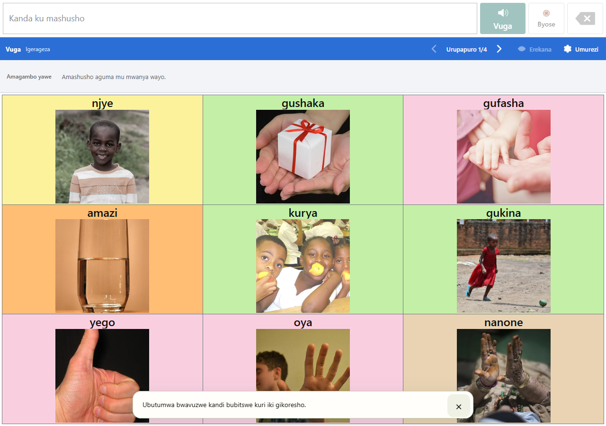
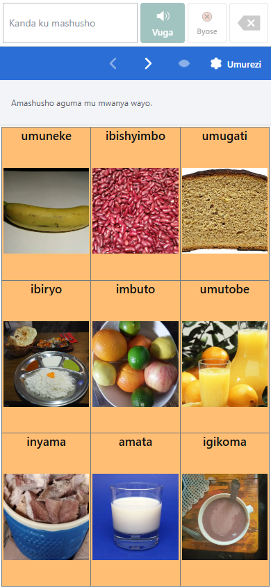
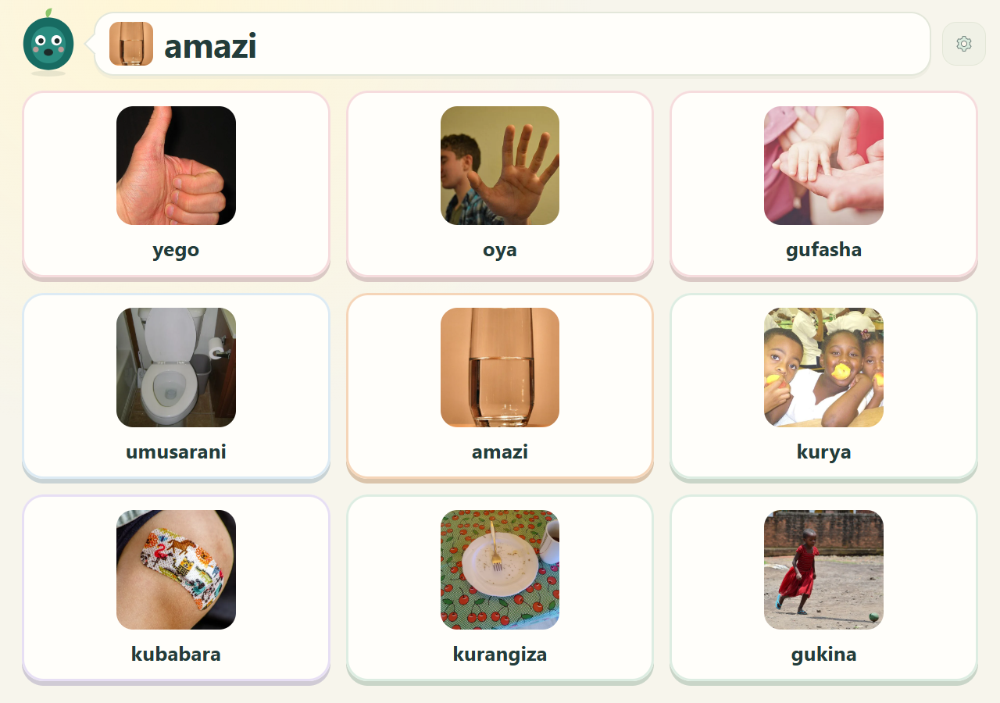
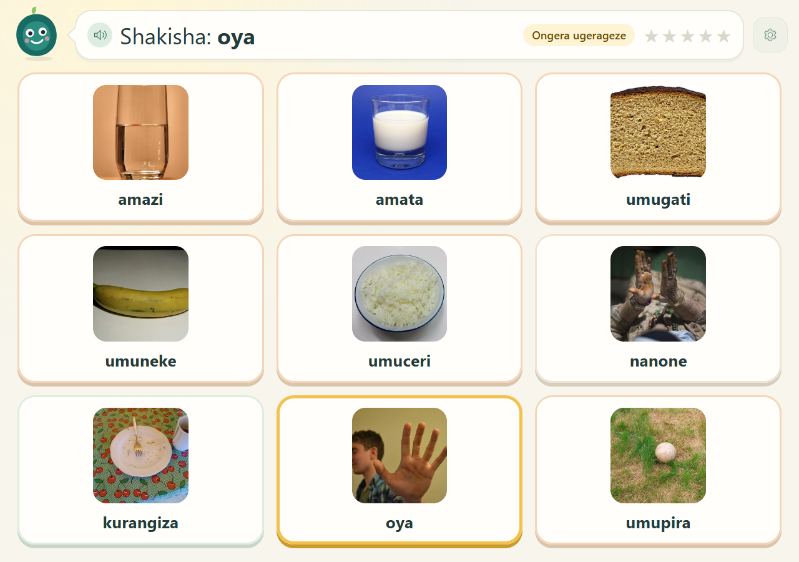
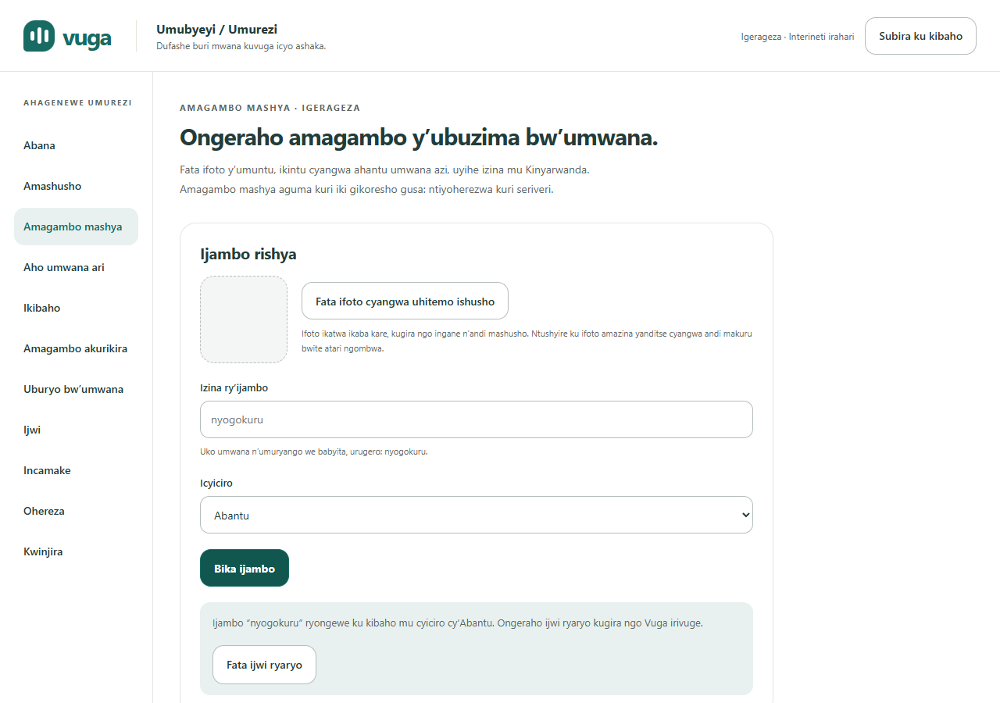
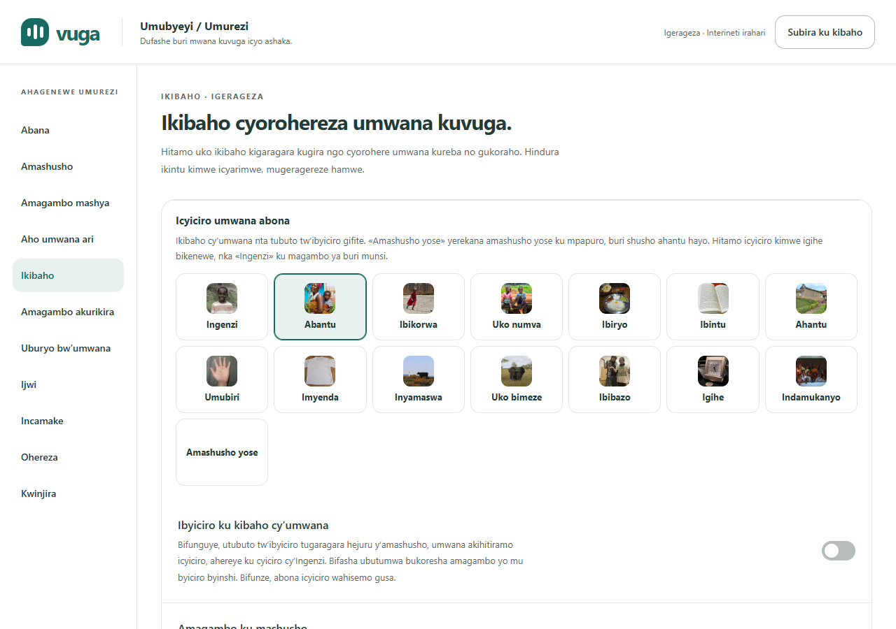
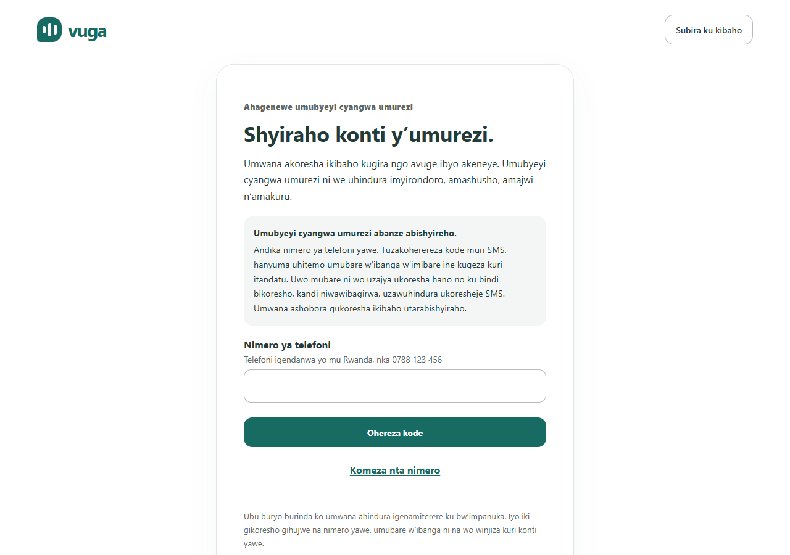
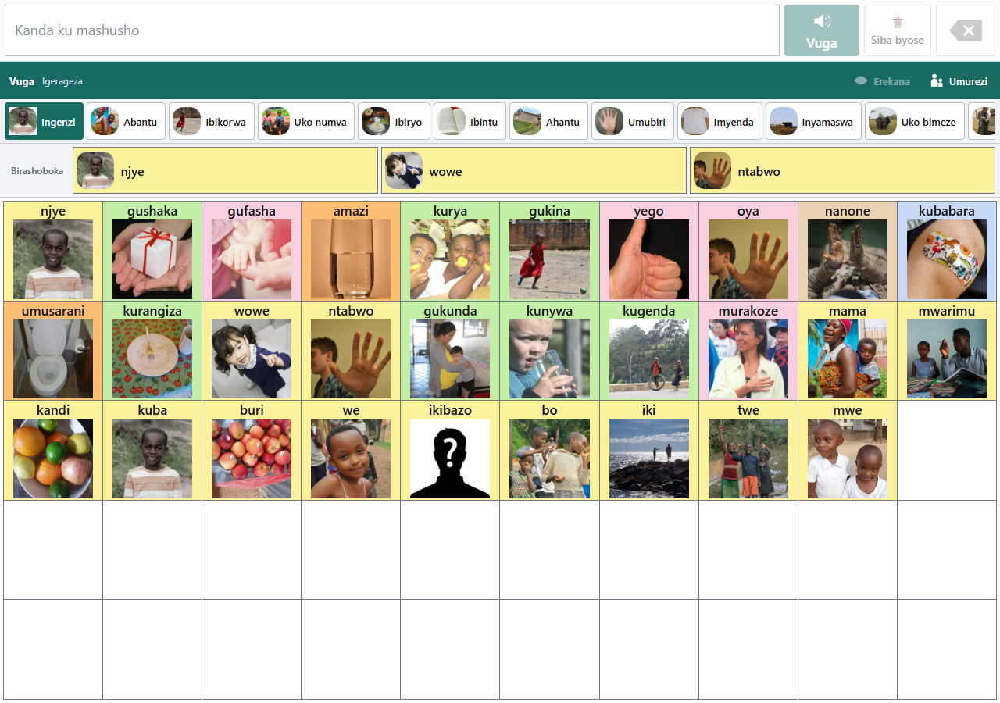

# Vuga AAC

**An offline Kinyarwanda picture-to-speech communication app for disabled children who cannot speak or are hard to understand, with on-device next-word suggestions that can learn each child's own words.**

| | |
|---|---|
| **Walkthrough video** | [Final product walkthrough](VIDEO_LINK_TO_ADD) |
| **Technical report (PDF, 4 pages)** | [docs/report/Vuga_Final_Technical_Report.pdf](docs/report/Vuga_Final_Technical_Report.pdf) |
| **Testing and performance evidence** | [docs/testing_report.md](docs/testing_report.md) |
| **GitHub repository** | https://github.com/jbyiringiro/capstone-project |
| **Project** | A Kinyarwanda-First Predictive Picture-to-Speech Communication System for Minimally Verbal Children with Disabilities in Rwandan Special Schools: Design and Preliminary Adult-Task Evaluation |
| **Evaluation** | Adults only (teachers, therapists, caregivers) in a preliminary usability and task study; no children take part |
| **Author** | Josue Byiringiro, BSc Software Engineering (Machine Learning), African Leadership University |
| **Supervisor** | Junior Turatsinze |

## Project overview

Many disabled children cannot use speech to ask for help, make a choice, say "no" or join a conversation: children with autism, cerebral palsy, Down syndrome, intellectual disability or speech motor disorders such as childhood apraxia of speech. Rwanda's 2022 census counted 17,852 children aged 5 to 17 with a communication disability ([NISR](https://beta.statistics.gov.rw/file/14175/download?token=zQsSYuB4)). Augmentative and alternative communication (AAC) lets them communicate with pictures and a device that speaks ([ASHA](https://www.asha.org/Practice-Portal/Professional-Issues/Augmentative-and-Alternative-Communication/)), but most AAC apps are in English, are expensive, or need dedicated hardware or a constant connection.

**Vuga** ("speak") is a free Kinyarwanda AAC app that runs on an ordinary Android tablet or phone and works fully offline after the first visit.

**For the child**
- Tap picture cards to build a message; **Vuga** (or a tap on the message bar) speaks it in Kinyarwanda, **Erekana** shows it full screen, **Siba** removes the last word.
- **A dense picture board with Vuga's own pictures** (new): a white speech display bar showing the chosen words (and the sentence Vuga will say), a thin green toolbar, and a dense grid of keys that fills the screen of any phone, tablet or laptop (up to 12 × 7, never below 2 cm). Each key has its word on top and its picture below, coloured by word type. Section tabs above the grid open at *Ingenzi*, the everyday words, and every picture keeps one place: words a caregiver hides leave an empty key instead of moving the others.
- **Each picture is said as soon as it is tapped** (new), so the child hears each word; Vuga then says the whole message.
- **Next words after a picture** (new, a caregiver turns it on): tapping *kunywa* (drink) adds the word and opens the drinks in the same grid (amazi, amata, umutobe, icyayi, igikoma, igikombe…); one more tap finishes the choice and returns the child to the page they came from.
- **Spoken as a sentence** (new): the pictures are joined into a Kinyarwanda sentence, so njye + gushaka + amazi is said "Ndashaka amazi." and njye + ntabwo + gukunda + amata "Sinkunda amata." Rule-based on the device: subject and verb become one inflected word, states (ndananiwe), requests (Mama, ngwino hano), "where" questions (Umusarani uri he?) and places (mu rugo), using 1,259 generated word clips. A verb is only inflected for a person the message names: a picture on its own, or a verb with no person, keeps its own word (gushaka, never ndashaka). Anything the rules do not cover is said word by word. A caregiver can switch it off per child.
- 188 everyday words, each with a licensed photograph (or an ARASAAC pictogram) and a Kinyarwanda voice clip.
- Three suggested next words in a separate row, from a Kneser-Ney trigram running in the browser, so the main board never moves.

**For the parent, teacher or therapist** (the **Umurezi** area, behind a long press and a PIN)
- One profile per child, with its own vocabulary and board settings.
- **Amagambo mashya** (new in the final version): add a word from the child's life: take a photo, name it in Kinyarwanda, record it in a familiar voice. The word stays on the device, and in the caregiver's account backup once they sign in.
- **Board size** (new): fixed pages of 4, 6, 9, 12, 20, 24 or 40 pictures with page buttons, or **Byikora**, which fits as many large pictures as the screen holds (fewer on a phone, more on a tablet). Every picture keeps its place. On a tablet, a sideways swipe across the pictures also turns the page; a caregiver can switch swiping off for a child who turns pages by accident.
- **Aho umwana ari** (new): choose where the child is (home, school, a meal, play, the clinic, outside). That place's naming words then come first on the board, followed by the core words, actions, feelings and the body, which stay everywhere; naming words for other places leave the board. The toolbar names the place on every screen size. Each place's list can be edited per child.
- **Amagambo akurikira** (new): switch next-word pages on or off per child and choose which pictures follow which, for example remove *amata* after *kunywa*, or give a new picture its own next words.
- **Icyiciro umwana abona** (new, in Ikibaho): the section tabs are on by default, so the child picks a section, starting at Ingenzi. With the tabs switched off, the child sees every picture in pages, or the one section the caregiver chooses.
- **Amagambo afasha** (in Ikibaho): the three next-word suggestions (*Birashoboka*) are on by default on a new device, and a caregiver can turn them off.
- **Amagambo ku mashusho** (new, in Ikibaho): show each picture with its word, or pictures only (larger, and the message bar then shows pictures too).
- **Vuga buri shusho** (in Ikibaho): saying each picture on tap is on by default and can be turned off per child.
- **Personal suggestions** (new): suggestions re-ranked by this child's own frequency, recency and word pairs, computed on the device.
- **Child mode** (new, per child): for young or early communicators the child sees only the pictures the caregiver chose (a ready-made board such as *Igihe cyo kurya*, or up to 12 picked pictures), with no categories or buttons to manage. Each tap says the word at once and shows it large, with a friendly character reacting. The caregiver can start **Shakisha**, a picture-finding game on the child's own board that awards stars, highlights the answer after two misses and shows progress to the caregiver. Game play is never counted as communication, and child-mode data stays on the device.
- **Gusuzuma amagambo** (new, in Amashusho): for the vocabulary review interviews, the 32 words on the paper review sheet shown one at a time in the sheet's order, with the picture, label and voice exactly as the board has them. Answers go on the paper sheet; the screen stores nothing.
- **Nibagiwe umubare w’ibanga** (new): setting the PIN shows a one-time recovery code to write down. On the PIN screen, *Nibagiwe umubare w’ibanga* sets a new PIN with that code, or with a code texted to the number of the Vuga account linked to the device; every child's data stays. **Kwinjira** makes a new code.
- **Konti y’umurezi by mobile number** (new): the first time the caregiver area opens, the caregiver types their Rwandan mobile number, Vuga texts a six-digit code, and they choose a PIN of 4 to 6 digits. That one PIN opens the caregiver area on the device, also offline, and signs in to the account with the number on any other device, which then gets the account's copy back. A number that already has an account is told so and signs in with its PIN. A forgotten PIN is replaced with a new texted code, and changing the PIN in **Kwinjira** changes the account's too. Without internet, *Komeza nta nimero* keeps the PIN on the device only, and the number can be added later in **Kwinjira**. The texts go through Africa's Talking. A code works once, for 10 minutes and 5 tries; a number gets at most 5 codes an hour, and 5 wrong PINs lock it for 15 minutes.
- **Ibibitswe kuri konti** (new, optional, in Ohereza): once the device is linked to the caregiver's number, everything set up on it (children, their words, board, place and next-word settings, child mode, custom words with their photos, and recorded voices) is saved to their account each time they return to the board. Signing in on a new phone or tablet brings it all back. A device that already has its own set-up never overwrites the account copy until the caregiver chooses. Messages stay on each device, and the backup never holds the PIN: a new device takes the PIN the caregiver signs in with. Unlike the rest of Vuga, this puts the caregiver's photos and voice recordings on the server.
- Large tiles, reduced motion, photos or pictograms, recorded familiar voices, a summary of completed messages, and export or sync only when the adult chooses.

**Optional server**: a FastAPI service for adult accounts (a mobile number confirmed by SMS, and the caregiver's PIN), child profiles, vocabulary, message sync, the caregiver's device backup, summaries and server-side prediction, with Swagger documentation.

**Status.** The app is complete for this milestone and passes 284 automated tests and checks (139 unit, 76 Python, 69 in the browser) plus a 9-configuration compatibility matrix ([testing report](docs/testing_report.md)). The vocabulary has 188 words with synthetic speech (Meta MMS-TTS) instead of the proposal's 300 to 500 words with human recordings: when the schedule slipped, this was the first item cut, as the revised proposal sets out (section 1.5), because the three research questions can still be answered with it. The words and speech await native-speaker and stakeholder review. The planned evaluation is a preliminary study with adults, not children; it has not run yet, so no participant findings are claimed.

## Technical requirements

| Component | Requirement | Tested with |
|---|---|---|
| App runtime (child's device) | Android 9+ with Chrome or Edge 105+, Safari 16+ or Firefox 110+ (container queries, IndexedDB, service worker); about 20 MB free for the offline cache | Edge 155, Firefox 155, WebKit 26.6 (Safari engine), tablet and phone profiles |
| App build | Node.js 20+ and npm 10+ | Node 24.12, npm 11.6 |
| Front end | React 18.3, Vite 5.4, vite-plugin-pwa 0.20 (Workbox), Dexie 4.4 (IndexedDB) | as listed |
| App tests | Vitest 2.1, fake-indexeddb 6.2, Playwright 1.63 with Microsoft Edge installed (Firefox and WebKit optional) | as listed |
| API and ML | Python 3.11+ | CPython 3.11.15 |
| API | FastAPI 0.141, SQLAlchemy 2.1, Pydantic 2.13, Uvicorn 0.54, bcrypt, python-jose; SQLite for development, PostgreSQL 16 in Docker | as listed |
| ML (optional) | NumPy 2.4, Matplotlib 3.11 for the notebook; PyTorch 2.14, ONNX 1.23 and onnxruntime 1.30 for the GRU; transformers 4.57 for the transformer baseline | as listed |
| Development hardware | Any laptop that runs Node and Python; a GPU is only needed to retrain the neural baselines | Windows 11, Intel Core Ultra 7 255H, 31 GB RAM |

## Installation and running

**1. Get the code**

```sh
git clone https://github.com/jbyiringiro/capstone-project.git
cd capstone-project
```

**2. Run the app** (the child's board needs nothing else)

```sh
cd app
npm ci
npm test                 # 139 unit and reference tests
npm run build            # production build with the offline service worker
npm run preview          # http://127.0.0.1:4175
```

For hot reload during development use `npm run dev` (http://localhost:5173). On Windows PowerShell, use `npm.cmd` if the execution policy blocks `npm`.

**3. Browser, compatibility and performance tests** (with `npm run preview` running in another terminal)

```sh
npm run test:browser     # 69 end-to-end checks in headless Microsoft Edge
npm run test:compat      # 9 browser/device configurations, writes docs/evidence/compatibility.json
npm run bench            # prediction latency in Node, writes nothing unless --out is given
```

`test:compat` starts its own servers. Firefox and WebKit runs need `npx playwright install firefox webkit`; missing engines are reported as skipped.

**4. Python: notebook, ML tests and the optional API** (from the repository root)

```sh
python -m venv .venv
# Windows: .venv\Scripts\activate    macOS/Linux: source .venv/bin/activate
python -m pip install -e "./ml[dev,notebook]" -e "./api[dev]"

python -m pytest ml/tests api/tests          # 76 tests, including the API load test
python ml/notebooks/run_notebook.py          # re-run the model notebook
python -m uvicorn app.main:app --app-dir api --host 127.0.0.1 --port 8000
```

Swagger UI is at http://127.0.0.1:8000/docs. Copy `.env.example` to `.env` and set `VUGA_MODEL_DIR=ml/artifacts`, `VUGA_CORS_ORIGINS` to the app's origin and, for persistent sessions, a `VUGA_JWT_SECRET` of at least 32 characters. Opening an account or replacing a forgotten PIN needs the code texted to the phone. Without an Africa's Talking key, the API sends no SMS and prints each code in its terminal instead, for example `SMS to +250788123456: Vuga: kode yo kwemeza nimero yawe ni 482913. …`. To send real texts, set `VUGA_AFRICASTALKING_USERNAME` and `VUGA_AFRICASTALKING_API_KEY` from an Africa's Talking app. With the username `sandbox`, the texts appear in Africa's Talking's free online phone simulator. `docker compose up` runs the API with PostgreSQL 16. Install `ml[neural]` to run the GRU/ONNX tests and retrain the neural baselines.

**Study analysis.** `ml/scripts/analyse_study.py` runs the pre-specified tap-reduction analysis (RQ3). `ml/scripts/analyse_vocabulary_review.py` summarises the vocabulary review sheets (RQ1): `--template` writes a blank sheet CSV in the paper sheet's order (`vocab/review_words.csv`), and `--reviews` (plus optional `--mentions`) gives each word's counts and a proposed accept, revise, exclude or unresolved status by a fixed majority rule, with `--log-out` drafting rows for `vocab/decision_log.md`. The proposals are only drafts: the native speakers and the researcher decide. Keep participant files in `study/`, which git ignores.

**Using the app.** The board opens directly, with no account. Hold **Umurezi** (or press it with the keyboard) for the caregiver area; on first use an adult types their mobile number, enters the code Vuga texts, chooses a 4–6 digit PIN and writes down the recovery code shown (*Komeza nta nimero* skips the number when there is no internet). Caregiver tabs: **Abana** (profiles), **Amashusho** (vocabulary, and the word-by-word review screen), **Amagambo mashya** (custom words), **Aho umwana ari** (words for where the child is), **Ikibaho** (the section the child sees, section tabs, suggestions, personal suggestions, sentence speech, speaking each picture, board size, motion, tile size, photos), **Amagambo akurikira** (next words after a picture), **Uburyo bw’umwana** (child mode, its pictures, the game and progress), **Ijwi** (speech and recordings), **Incamake** (summary), **Ohereza** (export, sign-in, sync and the account backup), **Kwinjira** (the linked number, change PIN, new recovery code).

## Repository structure

```
app/                         React PWA (the product the child and caregiver use)
  src/
    child/                   child mode: ChildBoard, ChildGame, FindGame (game rules), ready-made
                             boards, Mascot, word speaker
    board/                   full board: Board, SymbolCell, HoldButton, MessageDialogs,
                             MessageSession (ordered action log), grid pages, suggestions hook
    caregiver/               Dashboard shell and one component per tab, AudioSettings
    parent-access/           PIN gate (PBKDF2, cooldown, recovery code), the account by mobile
                             number (AccountLink) and the idle/background lock hook
    prediction/              Predictor base class, KneserNeyTrigram, PersonalHistory,
                             PersonalReranker, bounded top-k, benchmark
    grammar/                 SentenceBuilder: pictures to a Kinyarwanda sentence, with the
                             generated word table (grammar_rw.json)
    speech/                  audio source chain (recording, installed clip, bundled clip, system
                             voice, generated sentence words), SpeechPlanner, player, warm-up
    storage/                 Dexie schema and one module per store: profiles, vocabulary,
                             messages, recordings, custom words, board preferences, device
                             backup
    server/                  API client, mobile numbers and SMS codes, adult-requested sync and
                             the account backup
    symbols/                 catalogue (CSV + custom words), categories, picture preparation
    shared/                  icons and artwork, Kinyarwanda error handling
  tests/                     Vitest suites mirroring src/, with Python parity fixtures
  scripts/                   Playwright suites, compatibility matrix, predictor benchmark
  public/                    photos, Kinyarwanda clips, pictograms, model artefact, icons
api/                         FastAPI service
  app/routers/               thin HTTP handlers: health, auth, symbols, profiles, sync, predict
  app/services/              business logic: accounts, SMS codes and sender (Africa's Talking),
                             catalogue, profiles, sync, summary, model registry, domain errors
  app/                       main (composition root), dependencies, models (ERD), schemas, security
  tests/                     API, service and load tests
ml/                          vuga_ml package (data pipeline, morphology and sentence grammar,
                             n-gram, GRU and transformer models, re-ranker, metrics, study
                             analysis), scripts, notebook, tests
vocab/                       188-word Kinyarwanda vocabulary, lexicon, review-sheet word list,
                             decision log
docs/                        testing report, technical report, evidence JSON, screenshots,
                             deployment plan, project guide, dated verification records
design/                      Figma-importable mockups, tokens, icons
hardware/, device/           keyguard and talker firmware drafts (not built)
```

## Designs and screenshots

| Board with a 3×3 page (tablet) | Board on a phone |
|---|---|
|  |  |
| **Child mode: only the chosen pictures** | **Child mode: the Shakisha game** |
|  |  |
| **Caregiver: new words** | **Caregiver: board settings** |
|  |  |
| **Caregiver: first setup with a mobile number** | **A new board: section tabs and suggestions** |
|  |  |

More: [all final screenshots](docs/screenshots/final-2026-10-22/), Figma mockups and design system in [design/](design/README.md).

## Machine learning

The [model notebook](ml/notebooks/vuga_model.ipynb) ([HTML](ml/notebooks/vuga_model.html)) covers data engineering, visualisations, architecture and metrics on Kinyarwanda sentences mapped to the board vocabulary (validation set):

| Model | Top-3 accuracy |
|---|---|
| Frequency baseline | 21.96% |
| Kneser-Ney trigram (shipped) | 45.78% |
| GRU | 46.92% |

The app ships the trigram: almost as accurate as the GRU, about 100 KB, and a suggestion takes 0.09 ms median in the browser. Its JavaScript port is tested against the Python model on every fixture prefix, as is the personal re-ranker.

## Deployment

The plan is in [docs/deployment_plan.md](docs/deployment_plan.md): the static PWA (`app/dist`) on Netlify or Cloudflare Pages over HTTPS, the optional API from `api/Dockerfile` on Render with managed PostgreSQL, and a pilot only after native-speaker and caregiver review.

## Licences

| Material | Licence |
|---|---|
| Code | MIT |
| Online photographs | Per-image licence and attribution in the [photo manifest](app/public/photos/manifest.json) |
| Synthetic Kinyarwanda speech (Meta AI MMS-TTS) | CC BY-NC 4.0 (non-commercial) |
| ARASAAC pictograms | CC BY-NC-SA 4.0 |
| Training text (Digital Umuganda sentence corpus) | MPL-2.0, see the [notice](ml/notebooks/evidence/NOTICE.md) |

No held-out test examples, participant data, recordings or custom words are included in the repository.
