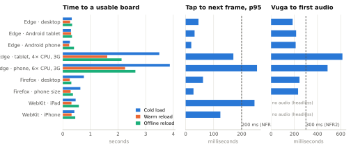

# Testing, validation and performance report

Final version, 22 October 2026; updated 23 October for the supervisor's proposal feedback, and on 2 November 2026 for the features added since (the dense grid with swiping, places, next words, the account backup and the caregiver account by mobile number), the new defaults (section tabs and suggestions on), and the review fixes made the same day: PIN tries counted atomically, sessions ended by a new PIN, account-copy revisions, no names or media in the account copy, speech prepared while the child composes, and corrected test and evaluation logic; and on 3 November for three server fixes found in review: a PIN replaced while a sign-in or PIN change checks it no longer opens a session or changes it, a backup save is told the revision it wrote, and the account copy takes settings only in the app's own shapes. Every number below comes from a command in this repository; the raw
results are in [`docs/evidence/`](evidence/) and the browser screenshots in
[`docs/screenshots/final-2026-10-22/`](screenshots/final-2026-10-22/). Nothing here involves
children, caregivers or therapists: those evaluations have not happened yet (see
[Limits](#limits-of-this-evidence)).

## Summary

| Strategy | What it covers | Tool | Result | Command |
|---|---|---|---|---|
| Unit | Prediction, speech chain, storage, custom words, preferences, PIN, session ordering, CSV, picture cropping, child mode and the finding game, vocabulary review lists, sentence building, grid shape and pages, sections and places, next words, Erekana cards, device and account backup (revisions, differences, privacy), mobile numbers and the account client | Vitest + fake-indexeddb | **146 passed** (25 files) | `cd app && npm test` |
| Reference (parity) | Browser trigram and re-ranker give the same answers as the Python models | Vitest against fixtures exported by `ml/scripts` | Top-3 identical on 119 prefixes, probabilities within 1e-9 | `npm test` (`tests/prediction`) |
| Unit and integration (Python) | Data pipeline, n-gram maths, metrics, keystroke-saving simulator, morphology, study analysis, vocabulary review analysis (RQ1), sentence grammar table, GRU + ONNX parity; API accounts by mobile number (SMS codes, PIN lock, PIN tries sent at once, sessions after a new PIN, a PIN reset during a sign-in or PIN change), ownership, vocabulary, sync, account backup (revisions, the revision a save reports, refused names, free text and media), summary, prediction, Africa's Talking requests; hosting settings (PostgreSQL addresses kept intact, no SMS codes in a public host's log) | pytest, FastAPI TestClient | **98 passed** (ML 41, API 57) | `python -m pytest ml/tests api/tests` |
| End-to-end functional | The real production build in a browser: board, speech, parent access and the caregiver account by mobile number, two devices sharing an account copy, caregiver tabs, offline, custom words, grid pages, swiping, places, next words, personal suggestions, child mode and its game, vocabulary review screen, sentence speech | Playwright + Microsoft Edge | **70 checks passed** (25 + 15 + 21 + 9) | `npm run build && npm run preview`, then `npm run test:browser` |
| Sequential batch | 20 tablets' backlogs of 200 messages × 5 actions uploaded to the API one request at a time | pytest + TestClient | 4,000 messages, 20,000 events, idempotent resend | `python -m pytest api/tests/test_load.py` |
| Performance | Prediction latency (Node and in-app), tap-to-frame, Vuga-to-audio, load times, frame rate, heap | `bench-predictor.mjs`, `check-compatibility.mjs` | Tables below | `npm run bench`, `npm run test:compat` |
| Compatibility | 3 browser engines × desktop, tablet and phone profiles, plus emulated low-end hardware | Playwright (Edge, Firefox, WebKit) | **7 of 9 configurations passed in full, 2 partial** (no audio output in headless WebKit on Windows) | `npm run test:compat` |
| Simulation | Keystroke saving of the deployed trigram on the app's own board (section tabs, pages) over the validation messages | `vuga_ml.metrics`, `export-board-layout.mjs` | 14.4% on 20-key pages (target 30%) | see [section 5](#simulated-keystroke-saving-proposal-target-30) |

The two strategies the brief asks to explain in depth are covered first; the others follow the same
pattern (why, how, result, what changed).

## 1. Unit and reference testing

**Why.** The parts that decide what a child sees and hears (ranking suggestions, choosing which
audio to play, logging every action in order) are pure logic that can be checked exhaustively
without a browser. The browser trigram must also agree with the Python model it was trained as,
otherwise the evaluation in the model notebook would not describe the shipped app.

**How.** Vitest runs in Node with `fake-indexeddb`. Parity fixtures are produced by the Python
reference implementation (`ml/scripts/export_artifacts.py`, `ml/scripts/export_reranker_fixture.py`)
and the JS code must reproduce them: same top-3 on 119 validation prefixes with and without the
vocabulary mask, and re-ranked probabilities within 1e-9. The bounded-heap `topK` is checked against
a full sort on 300 random distributions with ties. Browser-only APIs (audio, Web Audio, speech
synthesis) are replaced by small fakes that record calls.

**Results.** 146 tests pass in 25 files, up from 35 before this iteration. New coverage: the `Predictor`
interface, the personal re-ranker and history replay, the speech source chain, audio warm-up, custom
words (validation, duplicates, deletion, device-only messages), grid-size preferences, CSV parsing
and picture cropping; child-mode boards and layouts, the finding game (rounds, no repeated target, hint after two misses, practice weighting) and device-only child-mode logging; the vocabulary review word list (32 bundled words in sheet order) and the lists the review screen offers, which never include a family's custom words; the sentence builder, which must say all 23 study messages exactly as printed on their cards, keep every picture's own word when it is alone or has no person, fall back to word by word for anything it does not cover, and only ask for clips the generator makes; and generated-clip playback with its fallback to the pictures' own words. Added after 23 October: the dense grid's shape on each screen (never below 2 cm) and its pages, where a hidden word leaves an empty key; board sections and the words for each place; next words after a picture, including a caregiver's own list; Erekana card sizes; Rwandan mobile numbers in any usual spelling; and the account client: a texted code opens the account with the PIN, a forgotten PIN is replaced with a code, each refusal is explained in Kinyarwanda with the wait, and the quiet sign-in after an unlock stops once the account no longer takes the device's PIN. Added on 2 November: the account copy carries each child known by a code with their words and settings, but never a child the family calls by name, a custom word, a photo, a recording, the PIN or the sign-in, and a restore keeps this device's custom words in the child's list; copies are compared child by child; a newer copy saved from another device is taken when nothing changed here and never replaced otherwise, until the caregiver keeps one side; a PIN change signs the device in again, and a session the server refuses is ended on the device.

**What changed because of it.** The re-ranker test showed that with the proposal's frozen weights
(w_freq 0.3, w_rec 0.3, w_ctx 0.5) a caregiver's custom word cannot reach the top three: history
adds about +1.3 log units, while the vocabulary mask floor puts an unseen word about 6.9 log units
below the weakest seen word. The test now documents this honestly instead of being tuned to pass;
a cold-start prior for custom words is listed as future work.

The two new API regression tests were run against the previous account code and fail there, as
they should: with 20 wrong PINs sent at the same moment the old code checked all 20 (the lock read
the count before any try was written), and a session opened before a PIN change still worked after it.

## 2. End-to-end functional testing in a real browser

**Why.** Many failures only appear in a real browser: IndexedDB transactions, the service worker,
native media playback, focus handling in dialogs, layout at phone width. These are exactly the
things the child depends on.

**How.** Four Playwright scripts drive the production build (`npm run build`, then
`npm run preview`) in headless Microsoft Edge with a fresh profile each time:

- [`check-kinyarwanda-browser.mjs`](../app/scripts/check-kinyarwanda-browser.mjs), 25 checks: a new
  device opens with the section tabs and suggestions on; all 188 photos and 188 Kinyarwanda clips
  decode; predictions never move the grid; rapid taps stay in order; Stop keeps the message;
  recordings override bundled clips; the account form refuses a missing or non-Rwandan mobile number
  in Kinyarwanda; offline reload keeps the profile, photos and speech; a missing clip offers Erekana.
- [`check-parent-access.mjs`](../app/scripts/check-parent-access.mjs), 15 checks: PIN setup and
  confirmation, cooldown after 5 wrong PINs (persisting across reload), PIN change, idle, background
  and reload locking, the written-down recovery code, damaged storage failing closed; and, against a
  stand-in for the API that ends sessions on a new PIN and keeps account copies by revision, the
  caregiver account by mobile number: an account opened at the first setup with the texted code and
  a chosen PIN (mismatched PINs and a wrong code refused), a device linked in **Kwinjira** taking the
  account's PIN, a forgotten PIN replaced with a texted code, a new device signing in with the
  number and PIN and getting the caregiver's settings back, five wrong PINs locking the number until
  a texted code sets a new one, and two devices sharing the account: the tablet, still holding the
  first copy and a session that the phone's new PIN ended, has its save refused, signs in again with
  the new PIN, sees what differs and keeps the phone's newer copy.
- [`check-final-features.mjs`](../app/scripts/check-final-features.mjs), 21 checks for the final
  features: custom words end to end (photo, duplicate and non-image rejection, board placement,
  Erekana without speech, familiar-voice recording, device-only sync state, deletion); 9-cell pages
  with page turns logged as actions, short pages padded, tiles at least 2 cm on a phone; a 40-cell
  grid and **Byikora** fitting a tablet and a phone with no page scroll; personal suggestions
  lifting a word the child uses; the vocabulary review screen showing the sheet words in order with
  buttons, arrow keys and their voice, and leaving messages, actions and vocabulary unchanged after
  it closes; I + want + water heard as the generated word `ndashaka` then `amazi`, with Erekana
  showing "Ndashaka amazi.", and word-by-word speech again when "Vuga interuro yuzuye" is switched
  off; next words after *kunywa* and a caregiver's own list for them; a chosen place's words first;
  each picture said on tap; the section tabs switched off and back on; pictures-only keys; and a
  sideways swipe that turns the page without choosing a picture.
- [`check-child-mode.mjs`](../app/scripts/check-child-mode.mjs), 9 checks: child mode shows only the
  chosen pictures with no categories, message strip or buttons; a tap speaks at once and is logged
  device-only; an accidental second tap within 0.6 s is ignored; ready-made and edited boards; the
  Shakisha game with a hint after two misses, five stars and no messages logged; caregiver progress;
  three columns over 2 cm on a phone; switching back to the full board.

**Results.** 70 of 70 checks pass with no uncaught page errors on this build, re-run on 2 November
2026 ([browser-report.json](screenshots/final-2026-10-22/browser-report.json),
[parent-access-report.json](screenshots/final-2026-10-22/parent-access-report.json),
[final-features-report.json](screenshots/final-2026-10-22/final-features-report.json),
[child-mode-report.json](screenshots/final-2026-10-22/child-mode-report.json)).

**What changed because of it.** Two layout faults were caught on screenshots, not assertions: the
first 3×3 page filled the width so only one row was visible on a tablet (rows now fit the screen,
and wide cells put the picture beside the word), and the page buttons reused the "back" icon, which
reads as delete (now chevrons). A pre-existing contrast fault was also found: hovering the active
category painted white text on a pale background. Since the board now reads a message's clips while
it is composed, the checks that once counted the files requested after Vuga now tell what played by
its length (from the audio manifests), which is closer to what a child hears.

## 3. Testing with different inputs

| Input | Expected behaviour | Verified by |
|---|---|---|
| Wrong PIN 5 times on the device | 30 s cooldown that survives reload; the child board stays usable | parent-access check 5 |
| Wrong PIN 5 times for an account | The number is locked for 15 minutes, with the wait in Kinyarwanda; a texted code lifts the lock | API tests, parent-access check 14 |
| 20 wrong PINs for an account sent at the same moment | Only 5 are checked, then the number is locked (four 401 and sixteen 429 replies); the right PIN is refused until the lock ends | API test, smoke test against the real server |
| A session opened before the PIN was changed or reset | Refused (401); the device then asks for the new PIN | API test, unit `api-client.test.js`, parent-access check 15 |
| A PIN reset with a texted code while a sign-in or PIN change is checking the old PIN | The old PIN opens no session and changes nothing (401); the new PIN works | API tests (interleaving forced) |
| Mobile number written as +250…, 250…, 0788 123 456 | Read as one number | unit `phone.test.js`, API tests |
| Missing or non-Rwandan mobile number | Refused in Kinyarwanda before any text is sent | unit, API tests, browser check 19 |
| Wrong, reused or expired SMS code | "Kode si yo cyangwa yararangiye"; a code works once, for 10 minutes and 5 tries | API tests, parent-access check 13 |
| Codes asked for too often | One a minute and 5 an hour per number; the app shows the wait | API tests, unit `api-client.test.js` |
| Opening an account for a number that has one, or resetting a number that has none | Told so, and offered the PIN sign-in or a new account | API tests, unit, parent-access checks 10, 14 |
| SMS service refuses the text | Reported in Kinyarwanda; no code stored and no wait imposed | API tests, `test_services.py` |
| An account-copy save from a device holding an older copy | Refused (409) with the newer copy's revision; nothing is replaced; the caregiver sees what differs and chooses | API test, unit `backup.test.js`, parent-access check 15 |
| Several devices saving on the same copy at once | One save is kept, the rest are refused | API test |
| Another device saving on a copy just before its first saver hears back | The reply gives the revision this save wrote, so the first device's next save is refused (409) instead of replacing the other's | API test (interleaving forced) |
| A child's name, free text, a photo, a recording or a PIN setting in an account-copy upload, including inside a setting's value or in place of an id or word key | Refused (422): every field must have the shape the app writes; the app never sends them, and sends settings an older version saved in their current shape | API tests, unit `backup.test.js`, parent-access check 10 |
| PIN with letters, or confirmation mismatch | Kinyarwanda error, nothing stored | unit `parent-access.test.js` |
| Custom word with an existing label (`Amazi`) | Refused: "risanzwe ku kibaho" | final-features check 2, unit |
| Text file chosen as a photo | Refused: "JPG, PNG cyangwa WebP" | final-features check 2, unit |
| Photo larger than 10 MB, empty file | Refused before decoding | unit `catalogue.test.js` |
| Silent or corrupt audio upload | Kinyarwanda error, recording not saved | browser check 16 |
| Word with no audio at all | Message kept, Erekana offered, no Speak event logged | browser check 24, final-features check 3 |
| Profile with no enabled words | Empty-board message pointing to the caregiver | browser check 6 |
| Device offline or server down | Board, photos, speech and suggestions work from the cache | browser check 22, compatibility matrix |
| 1,001 unsent messages | First 1,000 uploaded, 1 left pending and reported | unit `db.test.js` |
| Re-sending an uploaded message | Counted as a duplicate; different content with the same ID is a 409 | API `test_api.py`, `test_services.py`, batch test |
| Unknown symbol key or another account's profile in a sync batch | Whole batch rejected before any write | API tests |
| Message that uses a custom word | Never uploaded (`synced = -1`), still exported locally | unit, final-features check 4 |
| Child taps the same picture twice within 0.6 s | Treated as a slip of the hand: spoken and logged once | child-mode check 3 |
| Child misses in the game | Gentle wiggle and "Ongera ugerageze"; after two misses the right picture glows; the star is still earned | unit, child-mode check 5 |
| Game started with fewer than two pictures | Start button disabled; a board edited since returns safely to the child board | unit, ChildModeTab |
| Malformed or oversized child board in storage | Falls back to the default ready-made board | unit `child-storage.test.js` |

## 4. Sequential batch testing (API)

**Why.** A school may sync many tablets at the end of a day; the proposal's testing plan set
"20 tablets syncing 200 messages each".

**How.** [`api/tests/test_load.py`](../api/tests/test_load.py) creates 20 accounts and profiles and
uploads 4,000 completed messages (20,000 tap events) in 80 requests of 50 messages, then re-sends a
batch per tablet to check idempotency, and asserts the database counts. The requests are sent one at
a time, round-robin across the tablets, so this measures how fast batches are validated and stored;
it is not a test of concurrent load, which has not been measured. (Concurrency is tested separately
where it matters for correctness: 20 parallel sign-ins, 8 parallel backup saves and, with the
interleaving forced, a PIN reset during a sign-in or PIN change and a backup save acknowledged
just before another device's.)

**Results** ([api_load.json](evidence/api_load.json), SQLite, one laptop, run on 2 November 2026; the
sync code has not changed since): all 4,000 messages and 20,000 events stored exactly once; 776
messages/s; upload p50 61 ms, p95 73 ms; duplicate re-send p50 33 ms.

**What changed because of it.** The first measurement on the previous code took 12.75 s with p95
241 ms, because sync ran three queries per message. `SyncService` now validates a batch with one
set-based query each for owned profiles, stored messages and used event IDs; the same scenario
measured 5.1 s and p95 about 100 ms in the refactor run (timings vary by about ±40% between runs on
this laptop).

## 5. Performance

### Prediction (NFR2: under 200 ms on a low-end tablet)

[`bench-predictor.mjs`](../app/scripts/bench-predictor.mjs), Node 24 on an Intel Core Ultra 7 255H,
2,000 calls over the 119 fixture prefixes after warm-up
([predictor_bench_node.json](evidence/predictor_bench_node.json)):

| Implementation | Median | p95 | Load |
|---|---|---|---|
| Trigram before this iteration (`git show 28c1683:app/src/predictor.js`) | 2.23 ms | 6.50 ms | 11.7 ms |
| Trigram now (precomputed context totals, bounded-heap top-k) | **0.090 ms** | **0.155 ms** | 7.8 ms |
| Trigram + personal re-ranker (124-event history) | 0.155 ms | 0.306 ms | |

The old code re-summed every context's counts for every candidate word (O(V × |context|) per
suggestion); totals and type counts are now computed once when the model loads, making a suggestion
O(V) plus O(V log k) to select the top three.

### Speech start (NFR2: audio within 300 ms of pressing Vuga)

The first measurement was 476 ms on desktop Edge. Profiling showed the fetches took 14 ms and the
rest was the browser opening its audio output on first use (first clip 379 ms, later clips about
40 ms). The board now opens the output in advance with a silent Web Audio context. A first version
created it inside the first tap, which moved the cost there (tap p95 rose from 39 to 505 ms); the
`AudioContext` constructor was then measured at 413 ms of synchronous main-thread work, so it is
now built while the board is idle and taps only resume it. That brought speech start to **186 ms**
on desktop Edge and 212–245 ms on Edge and Firefox phone and tablet profiles (22 October).

On emulated low-end hardware the earlier 2 November matrix still measured 479 ms (4× CPU) and
778 ms (6× CPU) against the 300 ms target, so it was investigated the same day with
[`profile-speech.mjs`](../app/scripts/profile-speech.mjs) on the Pixel 5 profile. At 6× CPU the time
split three ways: 240–460 ms passed before the press even reached the page, inside Playwright's own
work (finding the button by its accessible name and checking it can be pressed, both slow under
throttling), which the metric had wrongly counted as the app's; then 180–760 ms before the app
called `play()`: re-reading `installed.json`, looking up recordings, fetching each clip through the
service worker (an MP3 took 120–200 ms) and redrawing every key to show the speaking state; and only
60–140 ms of media start. The board now prepares the message's audio in idle time while the child
is still choosing, keeps one installed-clip list, and redraws as speaking only once the sound has
started, and the matrix now times speech from the moment the press reaches the page. Profiled again
on this build, 8 presses per speed ([speech_profile.json](evidence/speech_profile.json)), `play()`
is called 1–7 ms after the press, and the first audio starts 73–124 ms after it at 4× CPU (117–231 ms
before the change, measured the same way) and 86–196 ms at 6× CPU (257–866 ms before). At full
speed the media start dominates either way (73–115 ms now, 70–95 ms before). These are times to the
media element's *playing* event; the device's output latency comes after it and cannot be seen in
headless runs.

A second cause appeared offline: every Vuga probed `/audio/WORD.wav` for optional installation
clips. With no network, the service worker's cache-first route failed that probe (about 2.3 s in
Firefox, a page error in WebKit). Installed clips are now listed in a precached
`audio/installed.json`, so the board never asks the network for files that do not exist; Firefox
offline speech start fell from 2,294 ms to 245 ms.

### Simulated keystroke saving (proposal target: 30%)

The board-layout simulator in [`ml/vuga_ml/metrics.py`](../ml/vuga_ml/metrics.py) now follows the
board as built: section tabs that open a section at its first page in one tap from anywhere, one
tap per page turn, a hidden word keeping its slot, Vuga returning the board to the first page of
Ingenzi, and suggestions picked in one tap that leaves the page as it was. It counts the fewest
all-action taps over every route (dynamic programming over section pages). The earlier simulator
modelled a home board with a Back key, which the board no longer has; it had not been used for a
reported number. The layout comes from the app itself
(`node app/scripts/export-board-layout.mjs`: 14 sections, 188 words), and
`app/scripts/study-message-sets.mjs` applies the same rules; both give the same totals for every
study message.

On the 319 validation messages (split v3, every word on the board), with the deployed trigram and
three suggestions ([results log](results_log.md)):

| Keys per page | Static board, taps | Predictive board, taps | Saving |
|---|---|---|---|
| 12 (4 × 3) | 3,662 | 2,981 | 18.6% |
| 20 (5 × 4) | 3,050 | 2,611 | **14.4%** |
| 40 (8 × 5) | 2,560 | 2,277 | 11.1% |

All three are below the 30% simulation target; unigram suggestions save 1.9–6.1%. Larger pages need
fewer page turns, which leaves suggestions less to save. The messages are filtered public text
mapped to pictures, not AAC messages, so this is an estimate, not a result for the study. The same
rules show the study's two message sets are matched only on 12-key pages (62 static actions each):
on 20-key pages set A needs 56 and set B 54, because *SLEEP* in A's "I tired want sleep" is on the
third page of Ibikorwa ([message_sets.json](study/message_sets.json) is regenerated at 20 keys per
page and records `matched: false`).

## 6. Compatibility across browsers and hardware

[`check-compatibility.mjs`](../app/scripts/check-compatibility.mjs) runs the same workflow on each
configuration with a fresh profile and its own preview server: cold load, warm reload, offline
reload (server stopped), caregiver PIN, in-app prediction benchmark, 20 taps with suggestions,
Vuga, then 2 s of page turns on the board of every picture (the board fits the screen and does not
scroll, so page turns are where the grid re-renders). Low-end hardware is emulated in Chromium with
CPU throttling (4× and 6×, Lighthouse's mid- and low-tier mobile factors) and a Fast 3G network for
the cold load. A configuration passes only when every check passes and the page logs no error;
otherwise it fails and the script exits with an error, as it does for a skipped engine. Headless
WebKit on Windows has no audio output, so a WebKit run whose speech cannot start is reported as
**partial**, provided the message stays and Erekana is offered (before 2 November such runs were
counted as passed). Speech is timed from when the press reaches the page (see section 5). Run on
2 November 2026 on this build; host: Windows 11, Intel Core Ultra 7 255H, 31 GB
([compatibility.json](evidence/compatibility.json)).

| Configuration | Status | Cold load | Warm | Offline | Prediction p95 | Tap→frame p95 | Vuga→audio | Page-turn fps (longest frame) |
|---|---|---|---|---|---|---|---|---|
| Edge 155, desktop 1280×900 | passed | 398 ms | 306 ms | 391 ms | 0.2 ms | 42 ms | 53 ms | 99 (47 ms) |
| Edge 155, Galaxy Tab S4 profile | passed | 494 ms | 261 ms | 329 ms | 0.2 ms | 37 ms | 53 ms | 110 (39 ms) |
| Edge 155, Pixel 5 profile | passed | 480 ms | 257 ms | 289 ms | 0.2 ms | 40 ms | 60 ms | 128 (16 ms) |
| Edge 155, Tab S4, **4× CPU, Fast 3G** | passed | 3,129 ms | 1,013 ms | 1,179 ms | 1.4 ms | 156 ms | 92 ms | 36 (255 ms) |
| Edge 155, Pixel 5, **6× CPU, Fast 3G** | passed | 3,479 ms | 1,778 ms | 1,797 ms | 1.9 ms | 299 ms | 146 ms | 44 (187 ms) |
| Firefox 155, desktop | passed | 743 ms | 251 ms | 287 ms | ≤1 ms* | 28 ms | 5 ms§ | 59 (47 ms) |
| Firefox 155, phone viewport | passed | 1,070 ms | 258 ms | 261 ms | ≤1 ms* | 30 ms | 5 ms§ | 64 (31 ms) |
| WebKit 26.6 (Safari engine), iPad profile | partial | 595 ms | 393 ms | 890 ms | ≤1 ms* | 203 ms | n/a† | 13 (566 ms)‡ |
| WebKit 26.6, iPhone 13 profile | partial | 435 ms | 285 ms | 482 ms | ≤1 ms* | 188 ms | n/a† | 29 (187 ms)‡ |

\* Firefox and WebKit round `performance.now()` to 1 ms for privacy, so sub-millisecond times show as 1 ms.
§ Firefox fires the *playing* event almost as soon as a prepared clip is played.
† Headless WebKit on Windows has no audio output; the message stayed and Erekana was offered.
‡ Headless WebKit on Windows renders in software; this is not representative of Safari on an iPad.

*Drawn from [compatibility.json](evidence/compatibility.json) by `python scripts/build_report_figures.py`. NFR2's 200 ms budget applies to prediction, so the tap panel has no target line.*

**Reading the results.** All nine configurations load, work offline, suggest words and keep every
check green; the two WebKit runs are partial because their speech could not be measured. Prediction
stays far inside the 200 ms budget even at 6× slowdown (1.9 ms p95), and speech now starts within
the 300 ms target everywhere it was measured: 53–60 ms in Edge at full speed and 92–146 ms under
4–6× emulation. The cost left on emulated low-end hardware is rendering: tap-to-frame p95 156–299 ms
and 36–44 frames a second while turning pages. A first visit over Fast 3G takes 3.1–3.5 s before the
board can be used; every later load comes from the device. The next optimisations would be fewer
re-renders per tap (memoised tiles) and smaller photos for low-memory devices.

**What changed because of it.** Offline testing in WebKit first failed. Stopping the server
instead of using Playwright's `setOffline` showed the app does work offline in WebKit: Playwright's
offline emulation does not reach WebKit's service worker. The matrix now stops the server for every
engine, which is also closer to a real loss of connection.

## Limits of this evidence

- All runs are headless on one laptop. CPU and network throttling emulate low-end devices; they are
  not measurements on a physical Android tablet, where offline installation, touch targets and
  speech start still need checking. The in-app benchmark (**Umurezi → Ikibaho → Umuvuduko**) exists
  so the study tablet can be measured directly.
- No usability testing with children, caregivers or therapists has taken place yet. The adult
  acceptance study and the vocabulary validation received ALU Research Ethics Committee approval on
  2 November 2026 (approval code SEPT26-BSE-048, valid for six months) and are planned for
  10–20 November; until they have run, no SUS score or tap-reduction result is claimed.
- No text has been sent to a real phone, so SMS delivery is not claimed as validated. The Africa's
  Talking client is tested against a stand-in for its API (request format and refusals), and the
  browser checks use a stand-in for the Vuga API. Runs against the real API server, with codes
  written to its log, opened an account on one device and restored it on a second, and (2 November)
  confirmed the lock under 20 parallel tries, sessions ended by a new PIN and refused stale backups.
- The race tests force each interleaving by running the second request inside the first, on SQLite.
  PostgreSQL, which hosting would use, has not been tested, and concurrent load has not been
  measured.
- The bundled speech is synthetic (Meta MMS-TTS) and has not been reviewed by a native speaker;
  playback events prove that audio played, not that it was understood.
- Model metrics are validation results from the September pipeline (split v3); the transformer
  result is from the earlier split v2 and was not rerun. The held-out test split has not been
  evaluated. Top-3 accuracy (45.8% deployed) and the simulated keystroke saving (14.4%) are below
  the proposal's targets (60% and 30%).
- With page turns counted, the study's two message sets are matched only on 12-key pages, so the
  study board's grid, or the sets, must be fixed before the sessions. Rebalancing the sets would
  change the approved message cards, which the approval's conditions ask to be emailed to the REC
  within 48 hours; a board fixed at 12-key pages keeps the cards as approved.
- Sentence speech is rule-based and covers common patterns (subject + verb, negation, states,
  requests, "where" questions, places); object pronouns and adjective agreement still fall back to
  word by word. The 1,259 generated words are synthetic and unreviewed, and the 23 reference
  sentences the tests compare against were drafted by the researcher, so passing tests show the
  rules are consistent, not that the Kinyarwanda is right.
- The vocabulary review analysis (`ml/vuga_ml/vocab_review.py`, 13 tests) is checked on constructed
  sheets only. Its majority rule proposes a status for each word; the decisions themselves are made
  by the native speakers and the researcher, and no review data exist yet.
